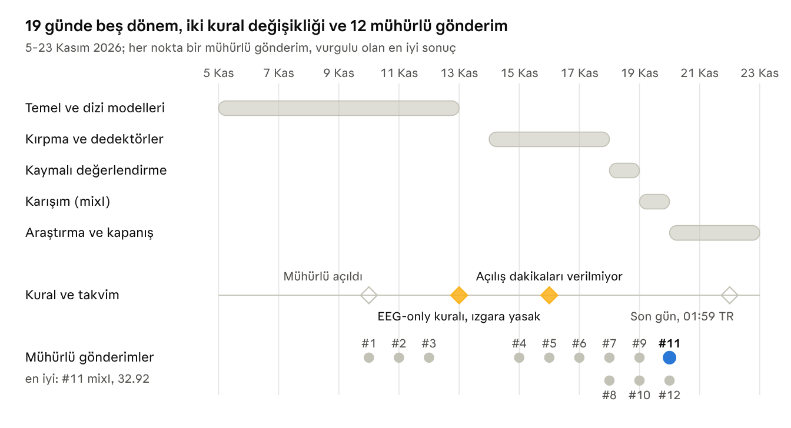
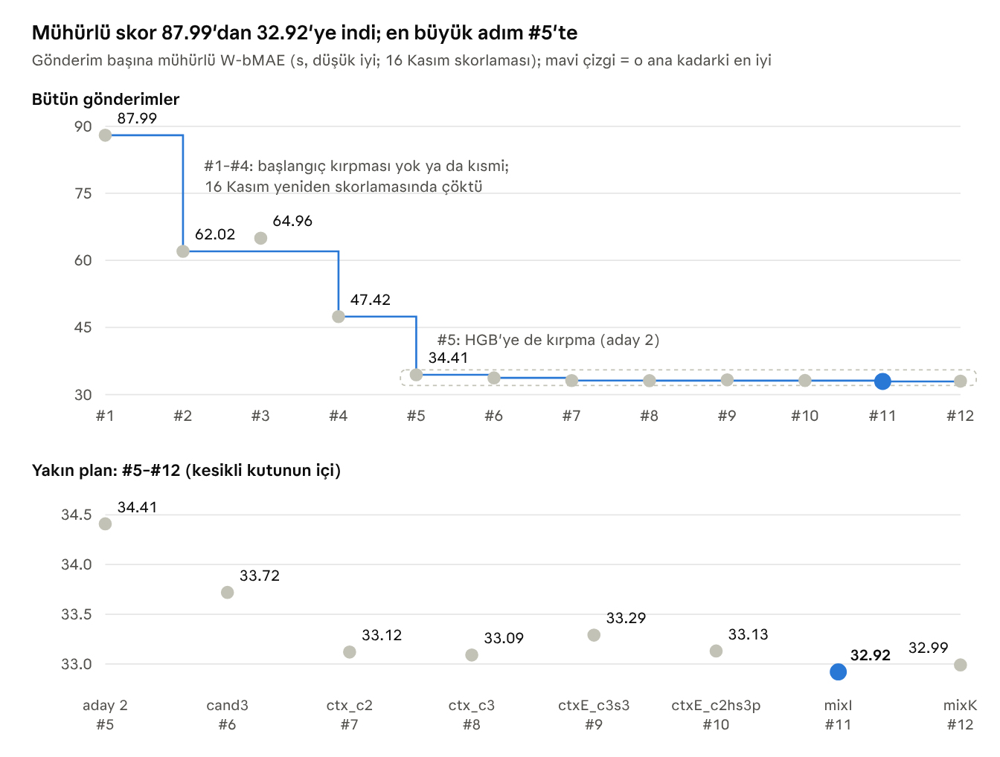

# Muse Uykuya Dalma Tahmini — Yarışma Süreci Raporu

23 Kasım 2026 · Bayram

> Bu dosya, aynı başlıklı Claude belgesinin 23 Kasım 2026 tarihli Markdown kopyasıdır. Çizimler `docs/img/` altında PNG olarak.

## 1. Yönetici özeti

Takım, EEG/EMG Foundation Challenge 2026 Track 03'ü (uykuya dalma tahmini) **mühürlü W-bMAE 32.92 s ile 198 takım arasında 26.** bitirdi. 5–23 Kasım arasındaki 19 günde 12 mühürlü gönderim yapıldı ve 16 Kasım yeniden skorlamasına göre ilk gönderimin 87.99'luk skoru 32.92'ye indi.

Süreci üç dış olay biçimlendirdi. 13 Kasım'da etiket düzenliliklerinden yararlanmak yasaklandı ve 30 sn ızgara hilemiz çöpe gitti. 16 Kasım'da mühürlü akışların kaydın ortasından başladığı ortaya çıktı ve bütün eski modeller çöktü. Mühürlü aşamada loglar gizli olduğu için her hata yalnız yerelde ayıklanabildi.

En önemli beş ders:

1. **Değerlendirme kurgusunu doğru taklit etmek, model mimarisinden daha değerli.** Tek en büyük kazanç (−2.68 s) yeni bir modelden değil, akış başlangıcı kırpma artırmasından geldi.
2. **Yerel CV ile mühürlü skor arasındaki ~0.2 s'lik farklara güvenilmez.** Yerelde −0.22 kazandıran iki değişiklik mühürlüde nötr ya da zararlı çıktı.
3. **Mühürlüye güvenilir biçimde taşınan tek şey, farklı modellerin ortalaması oldu** (mixI: iki bileşeninden −0.17 ve −0.21 iyi).
4. **Kalan hata büyük ölçüde bir bilgi sınırı.** Onset'e 1.5–5 dk ile 5–10 dk kalan pencereleri frontal/temporal EEG'den ayırmak zor; son işlem de, ham EEG'den uçtan uca model de bunu aşamadı.
5. **Tekrarlanabilirlik baştan tasarlanınca ucuz.** Deterministik eğitim, bit düzeyinde kimlik testleri ve Docker provası sayesinde 12 gönderimin hiçbiri teknik hatayla kaybedilmedi.

## 2. Yarışma ve görev

Görev, Muse kafa bandı EEG'sinden her 5 saniyede bir "ilk N2 uyku evresine kaç saniye kaldı"yı tahmin etmekti. Tahmin 600 s ile sınırlı ve kesinlikle nedenseldi.

| Konu | Ayrıntı |
| --- | --- |
| Yarışma | EEG/EMG Foundation Challenge 2026, NeurIPS 2026 Brain & Body Workshop; Codabench 17983 |
| Veri | Interaxon2026Muse (NEMAR nm000287): 540 kayıt, 203 kişi; 500 eğitim + 40 açık test |
| Girdi | 4 kanal (TP9, AF7, AF8, TP10), 128 Hz, µV; 5 sn'lik pencereler sırayla, birer birer |
| Çıktı | clip(N2 başlangıcı − pencere sonu, 0, 600) saniye |
| Metrik | W-bMAE: gerçek kalan süreye göre [0,40) ×10, [40,90) ×5, [90,300) ×3, [300,600] ×1; kayıt başına, sonra ortalama; görülmüş ve görülmemiş kişiler eşit ağırlıklı |
| Kurallar | Yalnız geçmiş pencereler; durum her kayıtta sıfırlanır; tahmin EEG'den gelmeli, etiket/paketleme düzenliliği yasak |
| Gönderim | Tek dosya `submission.py` + ağırlıklar; sunucu hiçbir paket kurmaz; 60 dk süre sınırı |
| Mühürlü aşama | 10–21 Kasım; loglar, tahminler ve skorlama çıktısı gizli, yalnız durum ve skor görünür; hak 5 → 7 → 12 |
| Donanım | Tek dizüstü: RTX 3050 (4 GB), 12 çekirdek, 11 GB RAM, WSL2 |

Metriğin şekli bütün tasarımı belirledi. Bir kaydın [0,40) aralığındaki 8 pencerenin her biri, [300,600] aralığındaki ~60 pencereden yaklaşık 75 kat daha ağır basıyor. Bu yüzden onset'e yakın hatalar affedilmez, uzak hatalar ucuzdur.

Açık verideki kritik tuzak: her N2 başlangıcı kaydın bitmesinden tam 300 s önce. Kayıt uzunluğu hedefi doğrudan ele veriyor; bu bilgi hiçbir modelde kullanılmadı.

## 3. Zaman çizelgesi

*Kaynak: git geçmişi, docs/status.md ve docs/submissions_log.md · 5–23 Kasım 2026*

Süreç iki kural değişikliğinin etrafında şekillendi. 13 Kasım değişikliği dayanıklılık dönemini başlattı; 16 Kasım değişikliğinden sonra seçim kaymalı değerlendirmeye taşındı. Gönderimlerin üçte ikisi son beş güne (16–20 Kasım) sığdı.

## 4. Teknik yolculuk 1: temelden üçlü diziye (5–12 Kasım)

Bu dönemde yerel çift CV 60 s'lik tabanlardan 39.40'a indi. Kazancın çoğu üç karardan geldi: nokta tahmini yerine dağılım tahmini, nedensel GRU ve farklı dizi modellerinin ortalaması.

**Kurulum (5 Kasım).**

- **Ortam:** WSL2, Python 3.12 ve neuralbench 0.4.0 kuruldu; veri NEMAR manifestine karşı doğrulandı.
- **Sunucu paket listesi:** worker imajındaki paketler çıkarıldı. LightGBM, XGBoost ve CatBoost yoktu. Bu yüzden ağaç modelleri scikit-learn HistGradientBoosting ile kuruldu ve çıkarımda numpy'ye çevrildi.
- **EEG'siz tabanlar:** sabit 35 s ve geçen süre kuralı 60.7 ile 61.3 aldı. EEGNet 3 tohumla 60.0'da kaldı, yani hiçbir şey öğrenemedi.

**Öznitelikler ve ağaçlar (5–9 Kasım).**

- **Nedensel öznitelikler:** pencere başına bant güçleri ve bunların EMA'ları, ilk-2-dk tabanına göre farklar ve geçen süre (321 öznitelik).
- **İlk HGB:** ağırlıklı L1 regresyon, çift CV 47.78.
- **Doğrulama:** 8 Kasım'da doğrulama kuralı kondu. Karar = (görülmemiş kişi 5 kat + görülmüş kişi 5 kat) / 2. Açık teste yalnız son kontrol için bakıldı.
- **En büyük sıçrama:** kalan süreyi 11 sınıfa bölüp HistGradientBoostingClassifier ile dağılım tahmin etmek. Karar, metriğin etkin pencere ağırlıklarıyla ağırlıklı medyan; skor 47.8 → 44.0.
- **Öznitelik grupları:** dinamikler, koşan maks./min., spektral şekil ve göz hareketi eklendi (817 öznitelik, 42.92). Dört üyeli bir topluluk 42.50'ye indirdi.

**Dizi modelleri (9–11 Kasım).**

- **GRU:** nedensel GRU (2 × 64) tek başına 41.66 aldı. HGB ile karışımı 40.43'e, 10 tohumla 40.28'e indi. Bu tarif 540 kayıtla eğitilip 10 Kasım'da **ilk gönderim (final540)** oldu.
- **mix3:** GRU, TCN ve CNN-gömmeli GRU'nun ortalaması + HGB, çift CV 39.40 (10/10 katta iyi). 11 Kasım'da ikinci gönderim oldu.

**Denenip geçmeyenler (11 Kasım):**

- sıcaklık ve aralığa göre α kalibrasyonu (±0.12);
- LSTM (+2.6);
- uzun bağlam öznitelikleri;
- iki aşamalı CNN kodlayıcı.

Kişi kimliği analizi önemli bir şey gösterdi. Kişinin diğer gecelerinin ortalaması bile [300,600] hatasını modellerimizden iyi tahmin ediyordu (ICC 0.38). Yani uzak aralıktaki hata büyük ölçüde "bu kişi ne kadar geç uyur" bilgisi; bu bilgi pencere EEG'sinde yok.

**Karar katmanı (12 Kasım).** Dağılım karışımı üzerinde yeniden eğitimsiz deneyler yapıldı. Biri güçlü çıktı: onset'lerin kayıt başından itibaren 30 sn'nin katına denk gelmesinden yararlanan "ızgara" kararı (−1.05, 10/10). Bu tarif üçüncü gönderim (gridpi) oldu. Bir sonraki bölüm bunun nasıl yasaklandığını anlatıyor.

## 5. Karşılaşılan kural değişiklikleri

Yarışma sırasında organizatörler mühürlü değerlendirmeyi iki kez değiştirip bütün gönderimleri yeniden skorladı. İkisi de bizim o ana kadarki en iyi fikrimizi geçersiz kıldı.

| Tarih | Değişiklik | Bize etkisi | Tepkimiz |
| --- | --- | --- | --- |
| 16 Kasım | Mühürlü kayıtların açılış dakikaları modele verilmiyor; geçen süre ilk verilen pencereden. Hak 12, günde 3. | Artırmasız modeller çöktü: final540 38.74 → 87.99, mix3 37.79 → 62.02, aday 1 37.09 → 47.42. Kırpma artırmalı aday 2 (34.41) etkilenmedi. | Kayma kalibrasyonu (İş A, İş D): akış başlangıcı ~U[2,5] dk. Seçim kaymalı çift CV'ye taşındı. |
| 13 Kasım | Tahminler EEG'den gelmeli; etiketleme/paketleme düzenliliklerinden yararlanmak yasak ve denetleniyor. "Akış kaydın başından başlar" ifadesi kaldırıldı. Hak 5 → 7. | 30 sn ızgara kararı (yerelde −1.05) yasaklı hale geldi; gridpi yeniden skorlamada 37.49 → 39.20 ile ızgarasız mix3'ün (37.79) gerisine düştü. | Izgara, π(D) ve epoch-hizalı öznitelikler her yerden çıkarıldı; kodda düzenlilik taraması yapıldı. Akış başlangıcına dayanıklılık testi yazıldı. |
| 10 Kasım | Mühürlü aşama açıldı (önce 17 Kasım'a ertelendiği duyurulmuştu). Takım başına 5 hak, günde 1. | Plan sabit kaldı. | final540 aynı gün gönderildi. |

16 Kasım değişikliğini önce kendi sonuçlarımızdan çıkardık. Aday 1'den aday 2'ye geçiş yerelde −0.37 kazandıracaktı, mühürlüde −2.68 kazandırdı. Bu tutarsızlıktan, mühürlü akışların kaydın başından başlamadığı hipotezi kuruldu (16 Kasım akşamı). FAQ notunu 18 Kasım'da gördük ve hipotezi doğruladı.

İki değişikliğin ortak dersi: açık veride çalışan her düzenlilik geçici. Kuralın lafına değil, ruhuna ("yalnız EEG'den tahmin") göre tasarlanan bileşenler iki yeniden skorlamadan da sağ çıktı.

## 6. Teknik yolculuk 2: dayanıklılık ve N2 dedektörleri (14–18 Kasım)

Bu dönem mühürlü skoru 37.09'dan (aday 1) 33.09'a (ctx_c3) indirdi. İki fikir birlikte çalıştı: akışın herhangi bir yerden başlayabileceğini eğitimde taklit etmek ve onset'i "gören" alan içi bir dedektör.

**Alan içi N2 dedektörü (İş 2, 14 Kasım).**

- **Kullanılmayan veri:** ham BrainVision dosyalarında onset'ten sonra tam 300 s veri vardı (540/540 kayıt), ama akış boru hattı kaydı onset'te kesiyordu.
- **Dedektör:** bu onset-sonrası pencereleri pozitif, onset'e ≥ 300 s kalanları negatif alan küçük bir CNN (35k parametre) eğitildi. Onset zamanı ya da kayıt uzunluğu girdi değildi.
- **Sonuç:** nedensel özetleri (EMA, koşan maks., 30 sn artış) HGB'yi 42.65 → 40.76'ya indirdi (−1.89, 9/10).
- **Geliştirme (İş 3, 15 Kasım):** çok sınıflı sürüm (onset'e ≥ 300 / 150–300 / 60–150 / 0–60 s ve onset sonrası) ve 3 tohum. Beklenen sınıf indeksi = "yakınlık"; B üyesinde ek −1.09.

**Akış başlangıcı kırpma artırması (14 Kasım).**

- **Tetikleyici:** 13 Kasım kuralından sonra yazılan dayanıklılık testi. Akış yalnız 30 sn geç başlayınca bile mix3'ün W-bMAE'si +4.6 s kötüleşti; rastgele başlangıçta +34 s.
- **Suçlular:** ilk-2-dk tabanı, geçen süre ve koşan ekstremumlar.
- **Çözüm:** her epoch'ta eğitim kayıtlarının başı rastgele kırpılıp (%50 yok, %35 ilk 1–12 pencere, %15 daha uzun) bütün nedensel girdiler kırpılan noktadan yeniden kuruldu. Rastgele başlangıç zararı 34 → 4.2'ye indi.
- **Aday 1 (15 Kasım):** HGB(dedektör) + kırpmalı GRU, çift CV 38.86 (−0.54, 8/10); mühürlü 37.09, 27. sıra.
- **Aday 2 (16 Kasım):** kırpma HGB tablosuna da eklendi (kayıt başına bir kırpılmış kopya), çok sınıflı dedektör ve deterministik dizi modelleri. Yerelde yalnız −0.37 bekleniyordu; **mühürlü 34.41 (−2.68, 12./160)** çıktı.

**Bağlamlı dedektör (İş C, 16–18 Kasım).**

- **Fikir:** dedektör tek pencere yerine son 6 pencerenin CNN gömmeleri üzerinde bir GRU çalıştırıyor; akışın ilk pencerelerinde bağlam sıfır dolgu.
- **Ayırma gücü:** Spearman −0.521 → −0.574.
- **Kurgu sadakati:** finallerde kırpılmış kopyaların bağlamı da kırpmadan başlıyor ("kırpma-kesin" yakınlık), yani eğitim, çıkarımda olacak olanın aynısı.
- **Sonuç:** iki paket çıktı. ctx_c2 (üç dizi modeli) ve ctx_c3 (yalnız GRU) mühürlüde 33.12 ve 33.09 aldı; ctx_c3 16./183 ile o güne kadarki en iyimizdi.

Yolda yakalanan bir sızıntı hatası (15 Kasım 23:07): GRU'nun kırpma artırmasında dedektör özetleri kırpılmamış kayıttan hesaplanıyordu, yani kırpılan başlangıç özetlere sızıyordu. Zincir durduruldu, özetler kırpılan noktadan yeniden akıtıldı ve eğitim yeniden başlatıldı.

## 7. Teknik yolculuk 3: kaymalı değerlendirme ve sınırları (18–19 Kasım)

Bu dönemde mühürlü kurguyu yerelde taklit etmek için iyi bir araç kurduk, ama araç küçük farkları doğru öngöremedi. İki gönderim (33.29 ve 33.13) en iyiyi (33.09) geçemedi ve bu, kalan sürecin karar kuralını değiştirdi.

**İş D — kayma kalibrasyonu.**

- **Yöntem:** gönderilmiş 8 modelin mühürlü skor *farklarını*, 40 açık test kaydında farklı akış başlangıcı dağılımlarıyla yeniden üretmeye çalıştık.
- **Sonuç:** en iyi uyum, tekdüze U[2,5] dk kayma (RMSE 2.76). Yani mühürlü akışlar ~3–4 dk içeriden ve değişken bir noktadan başlıyor.
- **Yeni araç:** bu dağılım (D) "kaymalı çift CV"ye dönüştü. Dışarıdaki kayıtlar D'den örneklenen bir noktadan akıtılıyor; 3 tekrar, sabit tohum. Birincil seçim ölçütü oldu.

**Bu araçla denenenler.**

| İş | Fikir | Kaymalı CV (D) | Mühürlü |
| --- | --- | --- | --- |
| F | ctx_c2 + ctx_c3 dağılım karışımı | −0.04 (6/10), geçmedi | gönderilmedi |
| E | Eğitim kırpmasını D'ye göre genişletme (%50 U[2,5] dk, %40 U[0,10] dk) | −0.22 (8/10), geçti | HGB tarafı nötr, GRU tarafı zararlı |
| G | HGB üyelerinin 3 tohum ortalaması | B üyesinde −0.18 (9/10) | ctxE_c3s3 33.29 (+0.20), ctxE_c2hs3p 33.13 (+0.04) |

**Ders: yerelde −0.22, mühürlüde +0.04 / +0.20.** Kullanıcı 19 Kasım'da yeni bir kural koydu: 0.2 s altındaki yerel farklara güvenilmeyecek, kararlar mühürlüde kanıtlanmış modellere dayanacak. Bu kural yüzünden GRU E içeren İş H iptal edildi.

**Sonradan bakınca bir ironi.** İş F'nin karışım fikri yerelde kuralı geçemedi (−0.04). Ama aynı fikir, mühürlüde kanıtlanmış iki modelle uygulandığında (mixI) en iyi sonucumuzu verdi. Yerel ölçümün çözünürlüğü, mühürlüde gerçekleşen ~0.2 s'lik kazançları ayırt etmeye yetmiyordu.

## 8. Son evre: karışım, son hak ve 0.72 araştırması (20–23 Kasım)

En iyi sonuç (32.92) yeni bir modelden değil, mühürlüde kanıtlanmış iki paketin yarı yarıya karışımından geldi. Son hak için yapılan araştırma 0.72'lik bir kazanç bulamadı.

**İş I — mixI_540 (19–20 Kasım).**

- **Tarif:** M = 0.5 · ctx_c3_540 + 0.5 · ctxE_c2hs3p_540. Yeniden eğitim yok; w = 0.5 önceden sabitlendi, CV'den seçilmedi.
- **CV'nin rolü:** yalnız akıl sağlığı. M hiçbir kayma dağılımında bileşenlerinden 0.10'dan fazla kötü olmamalıydı; en kötü +0.016 çıktı.
- **Testler:** eşdeğerlik testi (karar öncesi dağılım farkı 2.2e-16), Docker ×2.
- **Mühürlü: 32.92, 20./198.** İki bileşenden de iyi (−0.17, −0.21).

**Süre kalibrasyonu.** mixI'nin yerel süre oranı aday 1'e göre 1.66–1.83 ölçülmüştü, mühürlüde gerçek oran 1.43 çıktı (2178.67 s). Bundan yeni bir dönüşüm türetildi: mühürlü ≈ 1526.6 × yerel oran × 0.82. Son paket için iki sınır kondu: bu dönüşümle ≤ 2900 s, faktör 1.0 alınsa bile ≤ 3500 s.

**İş K ve İş J — son hak için iki paket (20 Kasım).**

- **mixK:** mixI tarifi, yalnız daha çok tohum. GRU ctx 10 → 20 tohum; HGB ctx'te B ve B_h2 üyelerine 3 tohum.
- **Kanıtlar:** tohum 0 yeniden eğitimleri eski modellerle bit düzeyinde aynı. Ek tohumların ağırlığı 0 yapılınca paket mixI ile bit düzeyinde aynı tahmin üretti.
- **Üçüncü öncelik (HGB E'ye de tohum) süre kuralını geçmedi:** tahmin 2980 s > 2900, faktör 1.0 ile 3635 s > 3500.
- **mixJ (yedek):** üç paketin ⅓'lük karışımı (α 13/30, dizi ağırlıkları 7:3:3).

**0.72 araştırması (20 Kasım akşamı).** Kullanıcı son hakkı ancak ≥ 0.72'lik kazanç vaat eden bir yöntemle kullanmak istedi; 32.92 − 0.72 = 32.20, ilk 10'un eşiğinin (32.16) hemen yanı.

1. **Hata anatomisi (kaymalı CV):** katkılar [0,40) 7.68, [40,90) 7.55, [90,300) 11.82, [300,600] 8.55. [300,600]'de model neredeyse her pencerede ~270 s eksik tahmin ediyor (ortalama tahmin 232 s), çünkü ağırlıklı medyan ×10'luk yakın aralıklardan korunuyor.
2. **Literatür:** Li ve ark. 2025 (Nature Neuroscience) uykuya dalmayı bir çatallanma (tipping point) olarak modelliyor. Uyku sinyali son ~10 dk'ya kadar düz, kritik geçiş 2–5 dk önce. Gerçek zamanlı tahminleri aynı kişinin önceki gecesini gerektiriyor.
3. **Geri sayım süzgeci:** önceki pencerenin dağılımı 5 s kaydırılıp şimdikiyle birleştirildi; 24 ayar denendi, en iyisi +0.001. Uzak aralıktaki kazanç, orta aralıktaki kayıpla birebir dengelendi.
4. **Uçtan uca ham EEG CNN→GRU (İş L):** tek başına 39.8 aldı. Eski iki aşamalı denemenin ~50'sinden çok iyi, ama karışıma katkısı −0.015 (6/10); kabul kuralı (−0.40) geçilemedi.

**Final.** Araştırma bir yol bulamayınca öneri uygulandı ve son hakta mixK gönderildi. Final sıralama en iyi skordan alındığı için bu gönderimin riski yoktu. mixK 32.99 aldı, yani tohum eklemenin farkı gürültü düzeyinde kaldı. Takımın final skoru 32.92'de kaldı: **26. sıra**.

23 Kasım'da `docs/method.md` final üretim zinciriyle tamamlandı. Elle yapılmış üç paket türetimi kodla yeniden üretildi ve gönderilenlerle bit düzeyinde aynı çıktı. GitHub için README yazıldı.

## 9. Mühürlü sonuçlar

*Kaynak: docs/submissions_log.md · 12 mühürlü gönderim, 10–20 Kasım 2026, 16 Kasım yeniden skorlaması*

Skorlar üç bölgeye ayrılıyor. #1–#4, akış başlangıcına dayanıksız ya da kısmen dayanıklı modeller; 16 Kasım yeniden skorlamasında 47–88'e düştüler. #5'te HGB tarafına da kırpma girince skor tek adımda 34.41'e indi. #6–#12 ise 0.8 s'lik bir bant içinde kaldı; bu bantta en iyi sonuç yeni bir modelden değil, iki modelin karışımından (#11) geldi.

Gönderim adı ve tarifleri: #6 yalnız GRU, #7/#8 bağlamlı dedektör, #9/#10 geniş kırpma ve tohum ortalaması, #11 karışım, #12 karışım + ek tohumlar. Yerel skorlar, SHA-256'lar ve süreler `docs/submissions_log.md`'de.

## 10. Mühendislik uygulamaları

Mühürlü aşamada loglar gizli olduğu için her paket, sunucuya gitmeden önce yerelde sunucunun yerine geçen bir test zincirinden geçti. 12 gönderimin hiçbiri çökmedi ya da zaman aşımına uğramadı.

**Doğrulama protokolü.**

- **Çift CV:** görülmemiş kişi 5 kat (kişi bazında GroupKFold) + görülmüş kişi 5 kat (birden çok gecesi olan kişinin bir gecesi dışarıda), ortalaması. Metriğin iki yarısını taklit ediyor.
- **İç içe seçim:** ağaç sayısı, epoch ve karışım α'sı her kat için diğer 9 kattan seçildi (LOFO). Final değerler bu seçimlerin medyanı.
- **Önceden yazılmış kabul kuralları:** her deneyden önce eşik ve kat sayısı belirlendi (ör. "Δ ≤ −0.5 ve 10 katın ≥ 8'inde iyi"). Kural geçilmezse ZIP yapılmadı.
- **Sonradan seçimi açıkça işaretleme:** örneğin ctxE_c2h bir bilgi satırı olarak görüldükten sonra seçildi. Bu, belgelerde "sonradan seçildi, yanlılık taşır" diye yazıldı.
- **Kaymalı çift CV (18 Kasım sonrası):** aynı kayıtlar, mühürlü kurguya kalibre edilmiş başlangıç kaymalarıyla.

**Tekrarlanabilirlik.**

- **Deterministik eğitim:** bütün sinir ağı bileşenleri cuDNN deterministic ve `use_deterministic_algorithms` ile, sabit tohumlarla eğitildi. HGB'de sabit `random_state`.
- **Bit düzeyinde kimlik kontrolleri:** aynı tohumla yeniden eğitim, paketleyici regresyonu (yeni paketleyiciyle eski paket → aynı akış tahminleri), sıfır ağırlık testleri.
- **Bulunan iki nondeterminizm kaynağı:** CNN kodlayıcı deterministik ayar olmadan yeniden eğitimde 0.36'ya kadar farklı ağırlık veriyordu; 12 Kasım'da düzeltildi. Bağlamlı dedektörün GPU ve CPU çıktıları ~3e-5 farklı; bu, bir HGB eşiğinde 4 pencerede 2.3 s fark yaratıyordu. Test referansı CPU'ya taşındı.

**Her pakette koşan test zinciri.**

1. **Paket bütünlüğü:** kaynak klasör == ZIP; import satırları ilk gönderimle aynı. v4-sealed imajı herkese açık değildi, bu yüzden yeni kütüphane eklememek bir kuraldı.
2. **Bileşen kimliği:** pakette her bileşenin açık test skoru, kendi eğitim logundaki değerle aynı olmalı.
3. **Akış ↔ toplu:** pencere pencere akış tahminleri, eğitim kod yoluyla toplu hesaplananlarla < 0.5 s.
4. **Girdi hataları:** NaN, ±inf, düz kanal, 1e30 ve 9 arıza senaryosu. Tahminler sonlu ve [0, 600] içinde kalmalı, durumlarda NaN olmamalı.
5. **Bağlam ve sıfırlama:** kısa bağlamlı akış başlangıçları ve `reset_state` testleri.
6. **Docker:** worker imajı (v3) üzerinde iki koşu; skorlar bit düzeyinde aynı olmalı.
7. **Süre:** referans paketle (aday 1) karışık sırada ölçüm, sonra mühürlü süre tahmini. Süre kuralı üç kez güncellendi: +%10 → +%50 → ×0.82 dönüşüm.

**Paketleme.**

- **Tek dosyalık sarmalayıcı:** `submission.py`; nedensel öznitelik akışı, numpy ağaç çıkarımı ve torch modelleri içinde.
- **Hız:** ağaçlar numpy dizilerine çevrildi (aynı model, sklearn yolu 417 s ↔ numpy 89 s); TCN tohumları vektörleştirilmiş akışla çalışıyor.
- **Geriye uyum:** yeni özellikler (üye ağırlıkları, ikinci HGB seti, tohum grupları) hep "anahtar yoksa eski yol" ilkesiyle eklendi, böylece eski paketler bit düzeyinde korundu.

**Uzun işler.** CPU ve GPU zincirleri kaldığı yerden devam edecek şekilde yazıldı. Bu, dört makine kesintisinde (14 Kasım Windows güncellemesi, 15 ve 17 Kasım yeniden başlatmaları, 20 Kasım WSL çökmesi) iş kaybını sınırladı.

## 11. Sosyal ve süreç boyutu

Proje, tek bir kişi (kullanıcı) ile bir yapay zekâ kodlama asistanının (Claude Code) 19 günlük ortak çalışmasıydı. Rol ayrımı baştan netti: **kararları ve gönderimleri kullanıcı verdi, asistan uyguladı, test etti ve belgeledi.** Asistan hiçbir gönderimi kendisi yapmadı.

**Çalışma sözleşmesi (CLAUDE.md).** Kullanıcı proje dosyasına kalıcı kurallar yazdı:

- Türkçe konuş; her adımdan önce ne yapacağını ve neden yapacağını açıkla, çünkü amaç öğrenmek.
- Büyük değişikliklerden önce plan çıkar ve onay bekle; her çalışan adımdan sonra commit öner.
- Emin olmadığın yarışma kuralını tahmin etme; belgeye bak ya da sor.

Bu dosya, onlarca oturum ve bağlam sıfırlaması boyunca ortak hafıza oldu. `docs/status.md` ve `docs/submissions_log.md` her oturumun ilk okunan dosyalarıydı.

**Kararlar nasıl verildi.** Belirleyici kararların hepsi kullanıcıdan geldi:

- **Süre kuralı (15 Kasım):** aday 1'e göre pencere başına en fazla +%50.
- **Birincil ölçüt değişikliği (18 Kasım):** seçim kaymalı CV'ye taşındı, kabul eşikleri yeniden yazıldı.
- **"0.2 s altındaki yerel farklara güvenilmez" kuralı (19 Kasım):** sonraki bütün seçimleri belirledi.
- **mixI'de ağırlığın CV'den seçilmeyip 0.5'te sabitlenmesi:** en iyi sonucu veren karar oldu.
- **Son hak için 0.72 eşiği.**
- **Araştırmada yol B'nin seçilmesi:** asistan A'yı önermişti, kullanıcı daha yüksek tavanlı B'yi seçti. Sonuç ikisi arasındaki farkı netleştirdi.

Kullanıcı asistanın önerisini sorguladı ve gerektiğinde reddetti. Son aşamada ise "önerin neyse onu yap" diyerek kararı devretti.

**Dürüstlük pratikleri.**

- **Olumsuz sonuçlar da kayda geçirildi:** her başarısız deney (LSTM, HMC, İş E/G, geri sayım, uçtan uca) sayılarıyla belgelendi.
- **Yanlılık açıkça işaretlendi:** sonradan seçilen bir paket ve örneklem içi skorlar belgelerde öyle diye yazıldı.
- **Gerçekçi beklenti:** kullanıcı 0.72'lik bir kazanç istediğinde asistan bunu vaat eden bir yol olmadığını söyledi. Üst sıradakilerin nasıl başardığı sorulduğunda da bunun bilinemeyeceğini belirtti.

**Asistan tarafının hataları (kayıtlara geçenler).**

| Tarih | Hata | Sonuç | Düzeltme |
| --- | --- | --- | --- |
| 23 Kasım | Rapor taslağında "FAQ'dan önce fark ettik" gibi doğrulanmamış bir iddia | Fark edildi | Yazım sırasında düzeltildi |
| 20 Kasım | Teşhis betiği bütün fold'ların ince dağılımlarını aynı anda bellekte tuttu (~10 GB) | WSL bellek darlığı, VS Code sunucusu çöktü | Fold başına ızgara düzeyinde saklama (2.5 GB) |
| 20 Kasım | Dört test zinciri paralel başlatıldı | torch iş parçacıkları birbirini boğdu, 10 dk'lık iş 60 dk'da bitmedi | Durdurulup sıraya kondu |
| 20 Kasım | `pkill` deseni kendi kabuğunu da eşledi | Komut kendini öldürdü | Kuyruk bir betik dosyasından başlatıldı |
| 18–20 Kasım | Belgede HGB ctx ağaç sayıları yanlış yazıldı (125/175/300/200) | Final belge hazırlanırken bulundu | Eğitim kaydına göre 200/200/300/200 |
| 15 Kasım | GRU kırpmasında dedektör özetleri kırpılmamış kayıttan hesaplandı (sızıntı) | Gece zinciri durduruldu | Özetler kırpma noktasından yeniden akıtıldı |

**Baskılar.**

- **Az ve pahalı gönderim:** hak önce günde 1 ve toplam 5'ti; her gönderim bir günlük kararın sonucu oldu.
- **Gizli loglar:** mühürlüde bir çökme olsa nedenini öğrenmenin yolu yoktu; bu yüzden yerel test zinciri bu kadar uzun.
- **Kural değişiklikleri:** yarışma ortasındaki iki değişiklik, o ana kadarki en iyi fikirleri bir gecede geçersiz kıldı.
- **Donanım:** 4 GB'lık dizüstü GPU, büyük ön-eğitimli EEG modellerini baştan devre dışı bıraktı. Gece boyu CPU zincirleri ve makine kesintileri olağan oldu.
- **Saat dilimi:** son tarih 21 Kasım 23:59 CET, yani 22 Kasım 01:59 Türkiye saatiydi; planlar bu farka göre yapıldı.

## 12. Öğrenilen dersler ve öneriler

En büyük ders: bu yarışmada kazançlar modelin kendisinden çok, değerlendirme kurgusunu ne kadar doğru anladığımızdan geldi.

**Teknik dersler.**

1. **Metriği kararlaştır, sonra modelle.** Dağılım tahmini + metrik ağırlıklı medyan, nokta regresyonunu bir hamlede 3.8 s geride bıraktı.
2. **Test kurgusunu eğitimde taklit et.** Akış başlangıcı kırpması, mühürlüde tek başına −2.68 s kazandırdı. Bunun bedelini (87.99'a çöken eski modeller) ancak kural değişince gördük.
3. **Kullanılmayan veriyi ara.** Ham dosyalardaki onset-sonrası 300 s, dedektör aracılığıyla HGB'ye −1.89 kazandırdı.
4. **Yerel ölçümün çözünürlüğünü ölç.** 500 kayıtlık CV ~0.2 s'nin altını güvenilir ayırt edemedi. O bölgede ancak mühürlüde kanıtlanmış bileşenlerle ve önceden sabitlenmiş ağırlıklarla ilerlemek işe yaradı.
5. **Topluluk çeşitliliği ucuz ve güvenilir.** Farklı modellerin ortalaması her yerde küçük ama sağlam kazanç verdi; aynı modelin daha çok tohumu ise vermedi.
6. **Kalan hata bir bilgi sınırı.** Onset'e 5–10 dk kala EEG'de onset'e dair güçlü bir işaret yok; literatür de bunu söylüyor. Son işlemle bu sınır aşılamaz.

**Süreç dersleri.**

1. **Kabul kuralını deneyden önce yaz.** Kurallar, yalnız yerelde güzel görünen çok sayıda fikri gönderimden önce eledi.
2. **Kural değişikliğine karşı ruha göre tasarla.** Izgara hilesi lafzen yasak değildi ama ruhuna aykırıydı; ilk yeniden skorlamada çöpe gitti.
3. **Durum dosyası ve karar günlüğü tut.** Onlarca oturum boyunca sadece belgeler sürekliliği korudu.
4. **Elle yapılan adımı hemen betikle.** Üç paket türetimi elle yapılmıştı; tekrar üretilebilirlik için yarışma sonrası kodlanmaları gerekti.
5. **Kaynak kullanımını hesapla.** Bellek (10 GB'lık teşhis) ve iş parçacığı (paralel testler) hataları, önceden yapılacak kaba bir hesapla önlenebilirdi.

**Benzer bir yarışma için öneriler.**

- **Dayanıklılığı ilk günden kur:** değerlendirmenin bilinmeyen yönlerine (akış başlangıcı, kayıt uzunluğu, eksik kanal) karşı tasarla; açık verideki düzenliliklere güvenme.
- **Gönderim haklarını ölçüme açık harca:** mühürlü skor farkları, yerel CV'nin göremediğini gösteriyor. Birkaç hak bilinçli olarak ölçüm için kullanılabilir.
- **Çeşitli bileşen havuzu hazır tut:** farklı mimari ve girdilerden gelen, ayrı ayrı mühürlüde ölçülmüş modeller, son günlerde en güvenilir kazancı verir.
- **Donanım:** daha büyük bir GPU, ön-eğitimli EEG modellerini ve daha geniş toplulukları deneme imkanı verirdi; bizim uçtan uca deneyimiz bunun tavanının sınırlı olabileceğini düşündürüyor.
- **Kişi bazında bilgi:** en büyük kalan hata "bu kişi ne kadar geç uyur" bilgisinden geliyor. Kurallar izin veriyorsa kişiye uyarlama en umut verici araştırma yönü.

## 13. Ekler: belgeler ve kaynaklar

Ayrıntıların tamamı proje deposunda; deponun GitHub adresi: [BayramGurbuz/Neural-Interfaces-2026-Track3-Sleep-Onset](https://github.com/BayramGurbuz/Neural-Interfaces-2026-Track3-Sleep-Onset).

| Belge | İçerik |
| --- | --- |
| `README.md` | Projenin İngilizce özeti ve yeniden üretim komutları |
| `docs/method.md` | Final yöntem: model, baştan ZIP'e üretim zinciri, tohumlar, tekrarlanabilirlik, hesaplama, dış veri beyanı |
| `docs/submissions_log.md` | 12 gönderimin her biri: tarif, komutlar, testler, SHA-256, yerel ve mühürlü skorlar |
| `docs/status.md` | Kronolojik proje günlüğü ve bütün deney sonuçları |
| `docs/external_data.md` | HMC veri beyanı (denendi, kullanılmadı) |
| `B_ASAMASI_RAPORU.md`, `KARAR_KATMANI_RAPORU.md`, `DURUM_RAPORU.md` | 11–16 Kasım deney raporları |
| `scripts/` | ~120 betik: öznitelikler, CV, eğitim, paketleme (`build_hgb_submission.py`), testler, `derive_bundles.py` |
| `submissions/mixI_540/submission.py` | En iyi gönderimin sarmalayıcısı (gönderilen ZIP ile bayt bayt aynı) |

Kaynaklar:

- [EEG/EMG Foundation Challenge 2026](https://neural-interfaces26.github.io/) ve [Codabench 17983](https://www.codabench.org/competitions/17983/)
- Veri: [Interaxon2026Muse, NEMAR nm000287](https://github.com/nemarDatasets/nm000287) (CC-BY-NC-SA-4.0)
- Li ve ark. 2025, "Falling asleep follows a predictable bifurcation dynamic", *Nature Neuroscience* 28: 2515–2525 ([PMC12672367](https://pmc.ncbi.nlm.nih.gov/articles/PMC12672367/))
- [HMC Sleep Staging Database 1.1](https://physionet.org/content/hmc-sleep-staging/1.1/) (PhysioNet, CC BY 4.0)
- [NeuralBench](https://facebookresearch.github.io/neuroai/neuralbench/)
